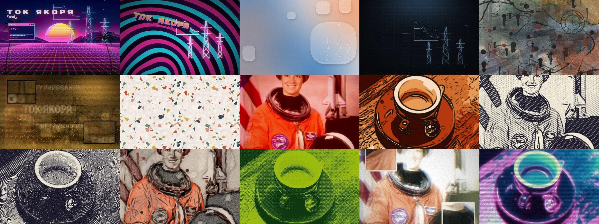

# Asset Tools — студия ассетов

Фильтры для фото, генераторы фонов и текстур, цепочки, варианты и анимация. Один и тот же код на Python работает
в трёх местах:

- **в браузере** — `index.html` на GitHub Pages: Python (Pyodide) с numpy, OpenCV и Pillow запускается прямо
  на странице, ничего не устанавливается, фото никуда не отправляются;
- **на компьютере в студии** — `python studio.py`: та же страница, но считает «родной» Python, быстрее и без
  ограничений по размеру;
- **в командной строке** — `python at.py …`: пакетная обработка, генерация, конвейер для сайта.

## Установка

    pip install -r requirements.txt                 # Python 3.10+: numpy, opencv-python, pillow
    python at.py list                               # что есть
    python studio.py                                # студия: http://127.0.0.1:8777

Для браузерной версии ничего не нужно: включите GitHub Pages для репозитория (ветка main, корень), и студия
откроется по адресу `https://<пользователь>.github.io/asset-tools/`. Первый запуск скачивает ~30 МБ Python,
потом всё берётся из кэша браузера. Pyodide лежит в `vendor/pyodide` — сайт не зависит от внешних CDN.

## Инструменты

| | Инструмент | Что делает |
|---|---|---|
| генератор | `ether` Эфир: сцена | вейпорвейв: солнце в полоску, неоновая сетка, каркасный сюжет, окно ретро-ОС, надпись в 「」, через фильтр «Сигнал»; анимируется |
| генератор | `neonsign` Неон: вывеска | неоновая трубка-сюжет на кирпичной стене или в волнах Hotline Miami, выдавленный наклонный заголовок; анимируется |
| генератор | `glass` Стекло: аура | цветная аура и стеклянные пластины с преломлением, бликом и гравировкой |
| генератор | `graphite` Графит: чертёж | точечная сетка, светящийся чертёж с размерами, шкалы |
| генератор | `watercolor` Акварель: фон | размывы, коллаж машинописи, эскиз тушью, брызги, Поллок |
| генератор | `film` Засветка: кадр | выжженная/ночная плёнка, силуэт, боке, слова, сплит-врезки |
| генератор | `tiles` Плитка | бесшовные текстуры (бумага, зерно, точки, клетка, строки, полутон, штриховка, мрамор, холст, терраццо) с проверкой стыка |
| генератор | `icon` Значок | иконка утилиты: плоская, глянец, неон, стекло, бумага, пиксели; favicon.ico |
| фильтр | `signal` Сигнал | аналоговый видеосигнал: YUV, сдвиг цветности, чересстрочность, снег, подписи |
| фильтр | `lines` Линии | рисунок по форме (FDoG/XDoG): перо, карандаш, тушь кистью, комикс, гравюра, муар |
| фильтр | `aquarelle` Акварель | пятна пигмента, тушь по форме, брызги и мазки |
| фильтр | `glare` Засветка | кросс-процесс, свечение, засветка края, двоение, врезки |
| фильтр | `neon` Неон | градиентная карта заката и неоновые контуры |
| фильтр | `palette` Палитра стиля | приводит фото к цветам стиля: градиент, ближайший цвет, растр |
| фильтр | `card` Обложка | превью ссылки 1200×630: фон, затемнение, заголовок, значок |

У фильтров с брызгами, засветкой и помехами есть параметр `protect` — «беречь главное»: по карте заметности
(спектральный остаток + лица, если OpenCV их находит) эффекты обходят лица и центр кадра.

«Линии» сделаны без нейросети: поток направлений по структурному тензору и разность гауссиан вдоль потока.
Нейросетевой детектор (HED) дал бы чуть более «смысловые» контуры, но весит ~56 МБ и не работает в браузере.

## Студия

- **Цепочка шагов**: генератор → фильтр → фильтр. Шаги включаются, выключаются и переставляются.
- **Параметры** с подсказками по-русски; двойной щелчок по ползунку — значение по умолчанию; замок 🔒 — не трогать при «Случайно».
- **🎲 Случайно** (R) с силой: 1 — что угодно в разумных пределах, 0.2 — рядом с текущим. **↻ зерно** (N) — другая раскладка при тех же параметрах.
- **Варианты ×9** (V): сетка из девяти вариантов вокруг текущего; щелчок — выбрать, и следующая сетка уже вокруг него.
- **До / после**: шторка между исходником (или предыдущим шагом) и результатом.
- **Макет ☀ / ☾**: поверх картинки — схема интерфейса утилиты в светлой и тёмной теме, чтобы видеть, не мешает ли фон тексту.
- **Плитка 3×3** для бесшовных текстур и оценка стыка.
- **История** миниатюрами, Ctrl+Z / Ctrl+Shift+Z.
- **Сохранить** (Ctrl+S): полный размер PNG/JPG/WebP + рецепт `.json`.
- **Ещё ▾**: открыть рецепт или старый `.json`; пакет — много фото → zip; анимация GIF/WebP (фаза, зерно или переход параметров).
- Фото можно перетащить, выбрать или вставить из буфера (Ctrl+V).

## Командная строка

    python at.py list                                         все инструменты и пресеты
    python at.py params lines                                 параметры инструмента
    python at.py photo lines фото.jpg --preset комикс
    python at.py photo signal "папка/*.jpg" --random 0.3 --variants 4 --out готово/
    python at.py gen ether --apps all --preset ночь --out фоны/
    python at.py gen tiles --preset мрамор --set size=512 --format png
    python at.py recipe мой.json фото.jpg                     цепочка, сохранённая в студии
    python at.py anim ether --preset ночь --frames 24 --format webp
    python at.py icons --look глянец --out иконки/
    python at.py parts watercolor --out детали/               мазок кисти, рваный лист, брызги, бумага

Общие ключи у `photo`, `gen`, `anim`:

| Ключ | Что делает |
|---|---|
| `--params` | показать параметры и пресеты |
| `--preset ИМЯ` или `--preset файл.json` | пресет или сохранённый результат (повторится один в один) |
| `--set имя=значение` | задать параметр (можно много раз) |
| `--random` / `--random 0.3` | случайно из разумных диапазонов / отклонение от пресета |
| `--lock a,b` | не трогать эти параметры при `--random` |
| `--variants 8` | сделать 8 вариантов |
| `--seed N` | зерно случайности |

Рядом с каждым результатом кладётся `.json` с параметрами — его можно открыть в студии или передать в `--preset`.

## Рецепт

    { "kind": "assetkit-recipe", "version": 1,
      "steps": [ { "tool": "ether", "params": { "palette": "полночь" }, "seed": 7 },
                 { "tool": "card",  "params": { "title": "Привет" }, "seed": 7 } ] }

## Конвейер для сайта

Описание сайта — `targets/*.json` (пример: `targets/knitu.json` для набора учебных утилит): где хаб и утилиты,
какие стили каким генератором рисуются, какие файлы хранят номер версии.

    python at.py pipeline targets/knitu.json                       все стили: фоны → CSS → сборка → версия
    python at.py pipeline targets/knitu.json --styles neon,glass   только эти
    python at.py pipeline targets/knitu.json --check               + проверка контраста в браузере с автопритемнением
    python at.py pipeline targets/knitu.json --styles none --assets   превью ссылок (og.jpg) и иконки страниц
    python at.py pipeline targets/knitu.json --dry                 показать план

Для `--check` нужны Node.js и `cd qa && npm install && npx playwright install chromium`. Проверка открывает
каждую страницу в обеих темах, меряет контраст текста к пикселям под ним и, если текст, лежащий прямо на фоне,
не читается, приближает этот фон к цвету темы и проверяет снова.

## Своё

- Новый фильтр: модуль в `assetkit/filters/` со `SPEC = Spec(...)` и `apply(img, p, seed)`; новый генератор —
  в `assetkit/gen/` с `apply(p, seed)`. Добавить в `assetkit/registry.py`, выполнить `python at.py manifest`
  (список файлов для браузерной студии) — и он появится везде: в CLI, студии и конвейере.
- Сюжеты утилит линиями — `assetkit/motifs.py`.

## Состав

    index.html, studio/          студия (страница, интерфейс, веб-воркер)
    assetkit/                    весь Python: params, core, registry, recipe, anim, api, pipeline, cli, server
      filters/, gen/             инструменты
      fonts/                     шрифты в комплекте (OFL), coverage.json
      manifest.json              список файлов для браузера (python at.py manifest)
    vendor/pyodide/              Python для браузера (Pyodide 0.27.7: ядро, numpy, OpenCV, Pillow)
    targets/                     описания сайтов для конвейера
    qa/                          проверка контраста (Node.js + Playwright)
    examples/                    примеры
    at.py, studio.py             запуск

Фильтр «Сигнал» написан по мотивам идеи [itorr/vaporwave](https://github.com/itorr/vaporwave) — у того проекта
нет лицензии, поэтому код и пресеты здесь свои. Pyodide — Mozilla Public License 2.0; numpy, OpenCV, Pillow — свои
открытые лицензии (BSD, Apache 2.0, HPND).
